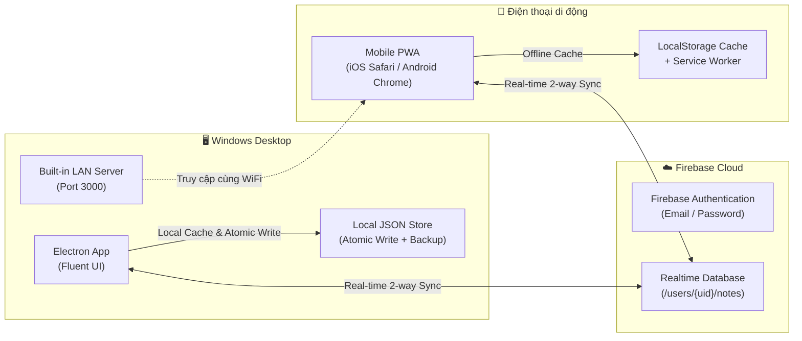

# 📌 Sticky Notes Fluent - Cross-Device Sync (Desktop ↔ Mobile)

<p align="center">
  
</p>

<p align="center">
  <strong>Ứng dụng ghi chú Windows 11 Fluent Design tích hợp đồng bộ hai chiều thời gian thực giữa Máy tính (Electron) và Điện thoại di động (PWA) qua Firebase Realtime Database.</strong>
</p>

<p align="center">
  
  
  
  
  
</p>

---

## 📖 Giới thiệu

Khi ngồi học tập và làm việc trên máy tính, bạn cần một ứng dụng **Sticky Notes** nổi trên màn hình (`Always on Top`), thao tác nhanh, hỗ trợ nhắc nhở hạn chót và checklist công việc. Nhưng khi rời bàn làm việc (đi học, ra ngoài, di chuyển), bạn vẫn cần xem và ghi chú tức thì trên **Điện thoại di động**.

Dự án này giải quyết triệt để nhu cầu đó:
- **Trên máy tính**: Ứng dụng **Electron desktop** chuẩn giao diện Fluent của Windows 11 với cửa sổ mini không viền ghim nổi trên màn hình.
- **Trên điện thoại**: Ứng dụng **Mobile Web PWA**, chỉ cần mở trình duyệt và chọn *"Thêm vào màn hình chính"* là có ngay app độc lập toàn màn hình.
- **Cầu nối**: **Firebase Realtime Database** giúp mọi thao tác gõ chữ, tích ô checklist hay đổi màu ghi chú cập nhật ngay lập tức giữa cả hai thiết bị.

---

## 🏗️ Kiến trúc Hệ thống (Architecture)



---

## ✨ Tính năng nổi bật

### 1. 🖥️ Desktop App (Windows Electron)
- **Chuẩn phong cách Windows 11 Fluent UI**: Bo góc mượt mà, hiệu ứng kính mờ Acrylic/Mica, chuyển động mượt mà.
- **Ghim nổi tuyệt đối (`Always on Top`)**: Giữ sticky notes luôn hiển thị trên mọi cửa sổ làm việc, không bị che khuất.
- **Checklist trực quan với thanh tiến độ xanh lá**:
  - Chế độ danh sách công việc rõ ràng.
  - Tích hợp **thanh tiến độ tỉ lệ phần trăm màu xanh lá**: Tích 1/3 mục -> thanh phủ 1/3, tăng dần đến đầy khi hoàn thành 100%.
- **Cảnh báo Khẩn cấp (Urgent Mode)**:
  - Báo động thị giác nhấp nháy ánh đỏ/cam.
  - Tự động đếm ngược thời gian hạn chót và phát âm thanh chuông cảnh báo nhẹ nhàng.
- **Bảo mật mã PIN (AES-256)**: Khóa các ghi chú riêng tư, nội dung được mã hóa an toàn.
- **Chạy ngầm System Tray**: Ẩn gọn xuống góc taskbar, khởi động cùng Windows khi bật máy.
- **Atomic File Write & Rolling Backup**: Đảm bảo an toàn 100% dữ liệu khi mất điện hoặc tắt máy đột ngột.

### 2. 📱 Mobile Companion (Progressive Web App - PWA)
- **Tối ưu trải nghiệm di động**: Nút bấm vừa vặn ngón tay cái, cử chỉ chạm mượt mà, hỗ trợ Safe Area cho màn hình tai thỏ/Dynamic Island.
- **Hỗ trợ PWA đầy đủ**: Cài đặt trực tiếp lên màn hình chính (Add to Home Screen), chạy như ứng dụng Native không thanh địa chỉ URL.
- **Lưu trữ Offline**: Vẫn xem và ghi chú bình thường khi mất mạng, tự động đồng bộ bù ngay khi có kết nối trở lại.
- **Đồng nhất tính năng**: Có đầy đủ đổi màu ghi chú, checklist với thanh tiến độ xanh lá, bật/tắt khẩn cấp và chỉnh deadline.

### 3. ☁️ Đồng bộ Thời gian thực (Firebase Realtime Cloud Sync)
- **Độ trễ thấp (Sub-second Sync)**: Thay đổi 1 chữ trên điện thoại, cửa sổ trên máy tính tự động nhảy chữ sau chưa đầy 0.5 giây.
- **Tài khoản cá nhân hóa**: Đăng nhập/Đăng ký an toàn qua Email & Mật khẩu trên Firebase Auth.
- **Máy chủ LAN nội bộ tích hợp**: Desktop app tự động dò IP mạng WiFi gia đình (ví dụ: `http://192.168.1.15:3000`) để điện thoại kết nối ngay lập tức mà không cần cấu hình phức tạp.

---

## 📊 Bảng so sánh tính năng

| Tính năng | 🖥️ Desktop App | 📱 Mobile PWA |
| :--- | :---: | :---: |
| Giao diện Fluent Dark / Light | ✅ | ✅ |
| Ghim nổi Always on Top | ✅ | — (OS quy định) |
| Checklist + Thanh tiến độ xanh lá | ✅ | ✅ |
| Chế độ Khẩn cấp (Urgent) & Hạn chót | ✅ | ✅ |
| Bảng 6 màu sắc Sticky Note | ✅ | ✅ |
| Mã hóa AES-256 / Khóa PIN | ✅ | ✅ |
| Hoạt động khi mất mạng (Offline) | ✅ | ✅ |
| Đồng bộ tự động 2 chiều tức thì | ✅ | ✅ |
| Chạy ngầm System Tray | ✅ | — |

---

## 🚀 Hướng dẫn Cài đặt & Khởi chạy

### 1. Chuẩn bị môi trường
- Yêu cầu cài đặt **Node.js** (khuyến nghị phiên bản 18+ hoặc 20+).

### 2. Cài đặt thư viện
Mở Terminal trong thư mục dự án và chạy:
```bash
npm install
```

### 3. Khởi chạy Ứng dụng Desktop
```bash
npm start
```
> **Mẹo trên Windows:** Bạn có thể click đúp vào file `Chay_App.bat` hoặc `Chay_App_An.vbs` để chạy app ẩn trực tiếp vào thanh Tray mà không hiện cửa sổ dòng lệnh đen.

---

## 📱 Hướng dẫn Kết nối với Điện thoại

### Cách 1: Sử dụng mạng WiFi nội bộ (Nhanh nhất)
1. Trên máy tính, mở cửa sổ **Hub** và nhấn vào biểu tượng **Đám mây ☁️** ở góc trên bên phải.
2. Tại mục **Tài khoản đồng bộ**, bấm sang tab **Đăng ký** (hoặc **Đăng nhập** nếu đã có tài khoản).
3. Sau khi đăng nhập, tại mục **Mở trên Điện thoại (Mobile PWA)**, bạn sẽ thấy đường link dạng:
   ```text
   http://192.168.1.x:3000
   ```
4. Mở trình duyệt (Safari trên iPhone hoặc Chrome trên Android) và truy cập đường link trên.
5. Đăng nhập cùng tài khoản email/mật khẩu vừa tạo.
6. **Cài đặt vào màn hình chính:**
   - **iOS (Safari):** Bấm nút Chia sẻ (Share) ➔ Chọn **Thêm vào MH chính** (Add to Home Screen).
   - **Android (Chrome):** Bấm biểu tượng 3 chấm ➔ Chọn **Cài đặt ứng dụng** hoặc **Thêm vào màn hình chính**.

### Cách 2: Triển khai lên Internet miễn phí (Firebase Hosting)
Nếu muốn mở ứng dụng trên điện thoại ở bất cứ đâu (kể cả khi dùng 4G ngoài đường hay ở trường học):
```bash
# 1. Đăng nhập Firebase CLI
npx firebase-tools login

# 2. Triển khai thư mục web lên Hosting
npx firebase-tools deploy --only hosting
```
Link truy cập web mobile toàn cầu của bạn sẽ có dạng:
```text
https://sticky-note-sync-58b02.web.app
```

---

## 📂 Cấu trúc Thư mục Dự án

```text
Sticky_note_app/
├── package.json               # Cấu hình dự án & dependencies (Electron, Firebase)
├── firebase.json              # Cấu hình triển khai Firebase Hosting
├── main.js                    # Entry point
├── Chay_App.bat               # Script khởi động nhanh
├── Chay_App_An.vbs            # Script khởi động app ngầm vào Tray
├── README.md                  # Tài liệu hướng dẫn sử dụng
│
├── src/
│   ├── config/
│   │   └── firebaseConfig.js  # Thông tin cấu hình Firebase Project
│   ├── main/
│   │   ├── index.js           # Main Process, điều phối IPC & vòng đời app
│   │   ├── syncManager.js     # Engine đồng bộ Firebase Realtime Database
│   │   ├── localServer.js     # HTTP Server nội bộ phát PWA qua mạng LAN WiFi
│   │   ├── store.js           # Lưu trữ JSON bền vững (Atomic write & backup)
│   │   ├── windowManager.js   # Quản lý các cửa sổ Hub & Sticky Note
│   │   ├── trayManager.js     # Điều khiển khay hệ thống (System Tray)
│   │   ├── security.js        # Module mã hóa PIN (AES-256 & Salt)
│   │   └── updater.js         # Kiểm tra cập nhật phiên bản
│   ├── preload/
│   │   └── index.js           # ContextBridge an toàn giao tiếp Renderer <-> Main
│   └── renderer/
│       ├── assets/            # CSS Fluent Design & Icons
│       ├── hub/               # Giao diện Trung tâm quản lý ghi chú (Hub)
│       └── note/              # Giao diện từng cửa sổ Sticky Note độc lập
│
└── web/                       # Mobile Companion PWA (Dành cho điện thoại)
    ├── index.html             # Giao diện Mobile Fluent tối ưu cho di động
    ├── style.css              # CSS Fluent Design tương thích màn hình cảm ứng
    ├── app.js                 # Logic đồng bộ Realtime Database trên Mobile
    ├── manifest.json          # File cấu hình PWA cài đặt vào màn hình chính
    └── sw.js                  # Service Worker hỗ trợ offline & cache nhanh
```

---

## 🛡️ Bản quyền & Đóng góp
Dự án được xây dựng và phát triển phục vụ học tập, công việc hàng ngày với hiệu năng cao và độ ổn định tối đa. Mọi đóng góp (Issue / Pull Request) luôn được hoan nghênh tại [duy83310-sketch/Sticky_note](https://github.com/duy83310-sketch/Sticky_note.git).
